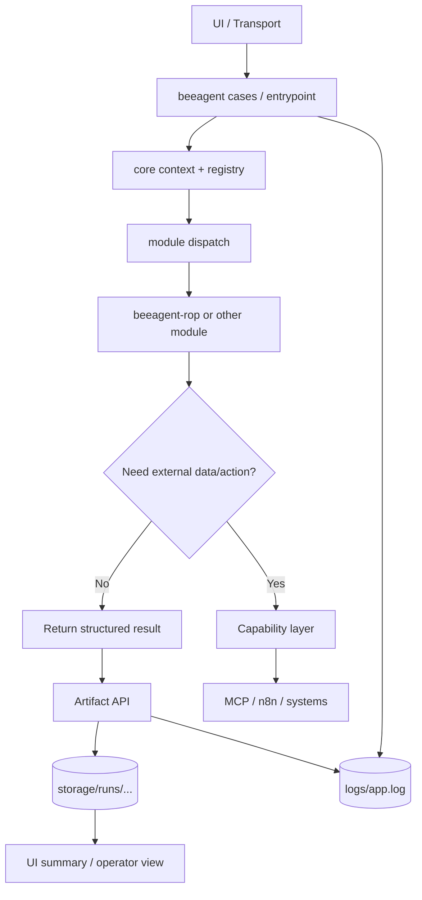

# ARCHITECTURE — BeeAgent (KISS, modular, stateful)

## Concept

There is an **orchestration core** (`beeagent`) and **pluggable domain modules** (`beeagent-rop`, with `beescan` and `merch` planned).

`beeagent` must not contain client-specific business logic. It manages:

- runtime state;
- run/session/job context;
- approvals;
- artifacts;
- module dispatch;
- capability boundary;
- transport/UI integration.

Domain modules must not become a “second core”. They handle their business cases within the contracts provided by BeeAgent.

## Basic principle

The correct arrangement is:

`UI/transport → BeeAgent core → module → capability/MCP/n8n → systems`

Where:

- **UI/transport** — Telegram, with web/Bitrix/other interfaces planned;
- **BeeAgent core** — orchestration, state, approvals, artifacts, policy;
- **module** — domain logic (`ROP`, later others);
- **capability/MCP/n8n** — execution/integration layer;
- **systems** — Bitrix, 1C, email, external services, etc.

## What lives in BeeAgent

`beeagent` contains only the platform layer:

- loading config and fail-fast validation;
- run/session/job context;
- stateful orchestration;
- case dispatch;
- module contract and registry;
- artifact API;
- capability boundary;
- transport/UI layer;
- observability/logging;
- approvals and bounded execution semantics.

## Bitrix write-back execution boundary (Iteration 37)

BeeAgent owns the bounded execution-capable Bitrix write-back path for ROP events:

- `BitrixReadonlyClient` remains strictly read-only; `crm.activity.list` is used only for idempotency reconciliation and does not give mutation capability;
- a separate `BitrixWriteClient` provides a bounded execution boundary with its own allowlist of exact mutation methods (`crm.item.add`, `crm.activity.add`, and, only for physical attachment file delivery in It40, `crm.activity.update`) and a separate env-backed write credential;
- attachment lifecycle (It40) — a BeeAgent-owned bounded opaque store `storage/attachments/<run_id>/` + per-run manifest, authenticated download and physical-file Bitrix delivery; `beeagent-rop` consumes only the bounded attachment extraction contract;
- authoritative write-back state lives in `storage/interfaces/rop_writeback_state.json` (durable, cross-run, idempotent); the per-run operator projection is `rop_writeback_summary.json`;
- `beeagent-rop` remains the source of the classification semantics and does not change; write-back authority is located in BeeAgent server-side policy, not AI/final decision/`should_rop_see`.

BeeScan-specific host integration lives in `beeagent_module.integrations.beescan`: `assessment`, `probe`, `policy`, `http_runner`, `detection`, `detection_policy`, `detection_runner`, `capture_worker`, `git_exposure` and `providers`. The detection runner loads its adjacent `capture_worker.py`; Git HEAD signature parsing remains in the installed BeeScan domain package. Generic host infrastructure stays in `core/`, including the existing `beedrill_toolchain` downloader used by provider provisioning.

## What does not belong in BeeAgent

`beeagent` must not contain client-specific logic such as:

- how to identify a new lead;
- how to find duplicates;
- how to build a ROP summary;
- how to read an attachment in the Welding context;
- how to interpret a particular client’s incoming stream.

This belongs in the module.

## What lives in the module

The module contains domain logic:

- domain models;
- rules;
- classification;
- deduplication;
- summary building;
- recommendation building;
- client-specific case semantics.

## What does not belong in a module

The module must not contain:

- transport handlers;
- its own orchestrator;
- its own runtime state engine;
- own storage core;
- ad hoc direct UI calls;
- ad hoc direct system calls when a capability boundary already exists for them.

## Data flow (target scheme)

1. A user or operator starts a scenario through UI/transport.
2. UI calls case/entrypoint inside BeeAgent.
3. BeeAgent defines:
   - `run_id`
   - `session_id`
   - `module_id`
   - `case_type`
4. BeeAgent through registry selects the appropriate module.
5. The module receives `ModuleContext`.
6. The module performs its domain logic.
7. If external actions or data are needed, the module goes through capability layer.
8. The result is stored in artifacts via BeeAgent artifact API.
9. UI/transport shows summary / next action / diagnostics.

## Flow for a Long Task

The long task must live in BeeAgent, not within one tool/MCP call.

That is:

- job state;
- checkpoints;
- retries;
- batching;
- approval state;
- intermediate artifacts

must live in BeeAgent runtime.

MCP/n8n is an execution/integration layer, not a place to store job state.

## Project directories (beeagent)

Recommended structure:

```
repo/
├── start.sh
├── pyproject.toml
├── config/
│   ├── start.py
│   ├── settings.yml
│   ├── prompts.yml
│   └── i18n/
├── docs/
│   ├── ROADMAP.md
│   ├── SDLC.md
│   ├── SECURITY.md
│   ├── ARCHITECTURE.md
│   └── DEV_GUIDE.md
├── src/
│   └── beeagent_module/
│       ├── core/
│       │   ├── app.py
│       │   ├── settings.py
│       │   ├── log.py
│       │   ├── paths.py
│       │   ├── llm.py
│       │   ├── normalize.py
│       │   ├── modules.py        # module contract / registry / loader
│       │   ├── artifacts.py      # artifact API
│       │   ├── capabilities.py   # capability boundary
│       │   └── context.py        # ModuleContext / RunContext / SessionContext
│       ├── integrations/
│       │   └── beescan/
│       ├── cases/
│       │   ├── ...
│       ├── agents/
│       │   ├── ...
│       ├── adapters/
│       │   ├── ...
│       ├── domain/
│       │   ├── ...
│       └── ui/
│           ├── telegram_bot.py
│           └── ...
├── storage/
├── logs/
└── tests/
```

## Our module contract

A module is a regular Python package connected to BeeAgent as a local dependency.

The minimum module must have:

- `module_id`
- `supported_case_types()`
- `handle(context)`

Where `context` contains a minimum:

- `run_id`
- `session_id`
- `module_id`
- `case_type`
- input payload
- access to artifacts/capabilities via bounded API

No complex plugin system, remote marketplace or dynamic installation at startup.

## Our capability contract

Capability is a bounded way to reach external systems:

- MCP;
- n8n;
- in another integration layer;
- in system connector.

The module must not need to know every detail of the transport/execution layer.

It must express something like:

- “retrieve data”
- “call workflow”
- “perform bounded action”

The BeeAgent capability layer decides exactly how this happens.

## Where customer modules must live

In separate repositories:

- `beeagent-rop`
- `beescan`
- `beeagent-merch`

And connect to `beeagent` as local/editable dependencies.

## Our UI contract

UI is a thin layer.

It must not:

- Contain client-specific business logic;
- Read storage directly;
- decide how the module works;
- replace orchestration core.

UI must:

- accept a command/event;
- invoke a case/module flow;
- Show the result.

## Mermaid diagram


